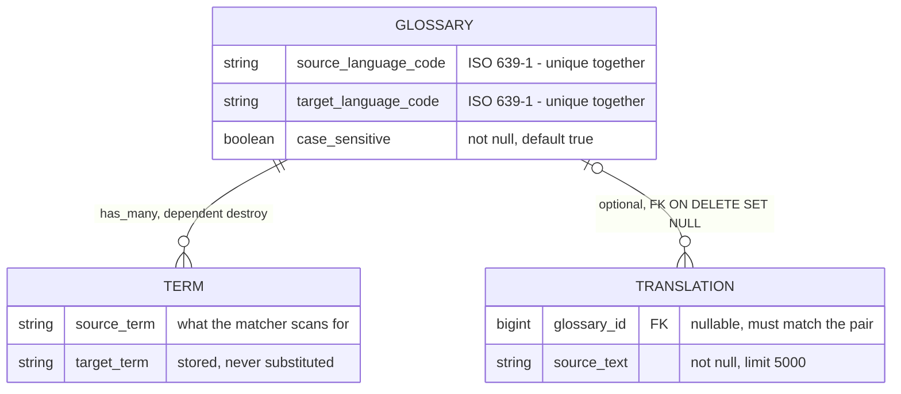
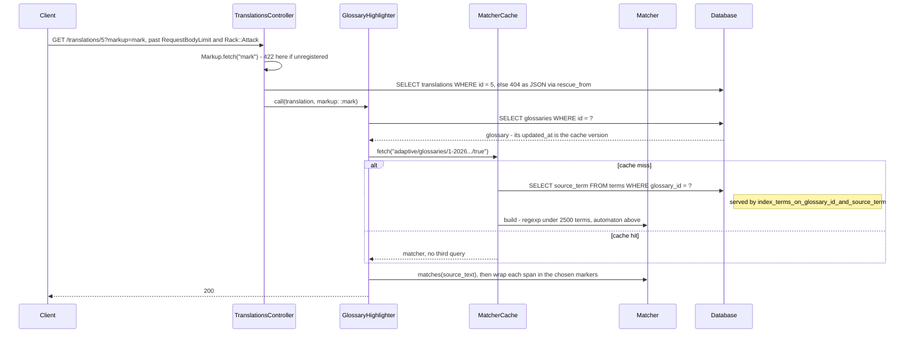

# Translator API

A Rails 7 API-only service for **glossary-aware markup**. Register a glossary — a language pair plus
a list of terms — attach it to a piece of source text, and reading that text back returns it with
every whole-word occurrence of a glossary term wrapped in markers.

## Despite the name, nothing is translated

There is **no machine translation here and no external provider.** Nothing is sent anywhere, there are
no API keys in the tree, and the only dependency is a database. Matching happens locally in
`app/domain/highlighting/`, and `target_term` is stored and served but never substituted for the
source term. A regression spec pins that: `spec/requests/translations_spec.rb` stubs both
`Net::HTTP.start` and `Net::HTTP.new` to raise before exercising the translation endpoints, so an
outbound call introduced later fails the suite loudly rather than quietly acquiring one.

## A round trip

From [`docs/api-session.md`](docs/api-session.md), a 24-exchange recorded session, abridged here to
`source_text`. `dogged` and `concatenation` survive even though `dog` and `cat` are terms:

```console
$ curl http://localhost:8380/translations/5
  "source_text": "The <HIGHLIGHT>cat</HIGHLIGHT> ate <HIGHLIGHT>ice cream</HIGHLIGHT> in <HIGHLIGHT>New York</HIGHLIGHT>, and the dogged concatenation stayed put.",
$ curl 'http://localhost:8380/translations/5?markup=mark'
  "source_text": "The <mark>cat</mark> ate <mark>ice cream</mark> in <mark>New York</mark>, and ...",
```

The rules, all pinned by `spec/domain/highlighting/matcher_spec.rb`: matches are **whole-word** (`cat`
never fires inside `concatenation`, using Ruby's default `\w`, i.e. `[0-9A-Za-z_]`) and
**leftmost-longest** (with both `New` and `New York` registered, `New York` wins and the shorter term
cannot split the span). Terms are **literals, never patterns** — one containing `5$` or `(` matches
those characters — and the stored row is never mutated. Case sensitivity is **per glossary**: when
`case_sensitive` is false the original casing survives, and folding touches a code point only when its
lowercase form is a single character, since a few (U+0130 among them) lowercase to two and would shift
every later offset.

`Highlighting::Markup` is a registry of marker pairs: `highlight` (default), `mark` and `brackets`
ship, `?markup=` selects one, an unregistered name gets a `422` listing the known ones, and a fourth is
one line in an initializer, needing no change to the matcher, controller or serializer:

```ruby
Highlighting::Markup.register(:xliff, open: "<mrk>", close: "</mrk>")
```

## Three tables



Both codes must be in `Glossary::ISO_639_1_CODES` (183 currently assigned codes; deprecated `bh`,
`sh`, `in` and `iw` are rejected). The invariants live in the database, not only in the model: the
unique index on the language pair, `index_terms_on_glossary_id_and_source_term` covering the only
query the highlighter makes, and the FK on `translations.glossary_id` being `ON DELETE SET NULL`, so
deleting a glossary detaches its translations rather than orphaning them.
`spec/models/database_constraints_spec.rb` inserts behind the validations with `insert_all!` to prove
all three; those examples pass on SQLite, which the suite runs on, and the same checks were re-run
against a scratch PostgreSQL database loaded from `db/schema.rb`, where the delete nullified and both
bad inserts raised too.

## What a read actually costs

Building a matcher is `O(Σ term length)` — for the regexp strategy, a `Regexp.union` over every term
plus a compile. Doing that per request is the part that scales with glossary size; the scan itself
barely does. `rake benchmark:highlighting` measures both halves, and `Highlighting::MatcherCache` — a
bounded process-local LRU keyed by `glossary.cache_key_with_version` — removes the first:

```
As shipped: default strategy, one 5000-character text (ms/call)
terms         picks       rebuild         cached          saved
10            regexp      0.268           0.228           1.2x
100           regexp      0.398           0.244           1.6x
1000          regexp      2.045           0.431           4.7x
5000          automaton   8.951           0.935           9.6x
```

That is committed [`docs/benchmark.txt`](docs/benchmark.txt) verbatim; re-running the task on the
same machine reproduced it within a few percent (1.1× / 1.6× / 4.7× / 9.1×), so treat the last digit
as noise and the shape as the result. Correctness rides on `Term belongs_to :glossary, touch: true`,
which bumps the cache key on term create, update **and** destroy — one example each in
`spec/domain/highlighting/glossary_highlighter_spec.rb` ("rebuilds after a term is added / changed /
destroyed").

## The Aho-Corasick matcher that lost

The scanner is a separate question from the cache, and the part of this repo worth reading, because the
measurement contradicted the textbook answer. Multi-pattern search over a large term set is exactly
what Aho-Corasick is for: one pass over the text, cost independent of how many patterns were added. So
one was written from scratch — `app/domain/highlighting/automaton.rb`, states as indices into parallel
arrays, transitions keyed by Unicode code point rather than single-character `String`, because
`String#each_char` allocates a String per character where `each_codepoint` allocates nothing. It works,
it is flat in N exactly as advertised, and it is **still about three times slower than the regexp it
was meant to replace** until the glossary reaches thousands of terms, because Onigmo scans an
alternation in C while this scans in Ruby:

```
Warm: matcher already built, highlight one 5000-character text (ms/call)
terms         automaton       regexp          speedup
10            0.733           0.225           0.3x
100           0.808           0.265           0.3x
1000          0.881           0.386           0.4x
5000          0.933           1.340           1.4x
```

Flat in N, and a loss at every realistic glossary size: shipping it as the default would have made
almost every request slower in exchange for winning an asymptotic argument. So it is not shipped
unconditionally. `Highlighting::AdaptiveMatcher` chooses per glossary at
`HIGHLIGHT_AUTOMATON_THRESHOLD` — default 2500 distinct terms, inside the measured crossover band
between 1000 and 5000, and movable by environment variable for a host where the crossover lands
elsewhere. Both strategies stay in the tree as peers in `Highlighting`'s strategy registry, and the
parity block in `spec/domain/highlighting/matcher_spec.rb` ("strategy parity on random input")
asserts they agree character-for-character on 200 seeded random term/text pairs, so the fast path
cannot drift from the reference one.

The summary: a real algorithm was implemented, benchmarked, found to lose on this workload, and kept
behind a measured switch rather than shipped on faith or quietly deleted.

## Inside a read

`GET /translations/:id` is the only endpoint that does real work. Everything else is CRUD.



A warm read is **two** queries whatever the glossary size, because terms are read only on a cache miss
— which is why this controller does not eager load, while `GET /glossaries` does.
`spec/requests/query_count_spec.rb` asserts the exact counts, and that warm equals cold minus one.

## Running it

Ruby 3.1.3 (`.ruby-version`, via rbenv or equivalent). PostgreSQL is needed to run the app but not to
test it: `config/database.yml` puts the test environment on SQLite, which is what lets CI run with no
service container, and `spec/environment/database_adapter_spec.rb` fails if that changes without
these instructions changing with it. `.github/workflows/ci.yml` runs the linter and the suite with
`CI=true`, eager loading the app so a lazily-resolving constant fails in CI rather than production.

```bash
bundle install
bundle exec rspec                        # 256 examples, 0 failures - SQLite, no server
bundle exec standardrb                   # zero offenses
bundle exec rake benchmark:highlighting  # regenerates the tables above
export DATABASE_NAME=translator_api_development DATABASE_HOST=localhost
bin/rails db:prepare db:seed             # 3 glossaries, 12 terms, 4 translations
bin/rails server
```

**Docker is unverified.** `Dockerfile` and `docker-compose.yml` exist — multi-stage build, non-root
`rails` user, `HEALTHCHECK` on `/health`, host ports 8380 and 8381 — and `docker compose config -q`
exits 0, but the image has never been built or booted here: this repo's uplift report records
`Build verified: NOT RUN — deferred, RAM constraint` and `Boot verified: NOT RUN — deferred, RAM
constraint`. Treat `docker compose up --build` as untested; only the local path above has been run.

Knobs belonging to this service rather than Rails — none a credential, none needed to test:

| Variable | Default | Effect |
| --- | --- | --- |
| `MAX_REQUEST_BODY_BYTES` | `1048576` (1 MiB) | Bodies above this get `413` before Rails parses them |
| `RATE_LIMIT_READS_PER_MINUTE` | `120` | Per-IP GET budget |
| `RATE_LIMIT_WRITES_PER_MINUTE` | `30` | Per-IP write budget |
| `HIGHLIGHT_AUTOMATON_THRESHOLD` | `2500` | Distinct-term count at which the adaptive matcher switches to the automaton |
| `SKIP_DB_SETUP` | unset | `1` stops `entrypoint.sh` running `db:prepare` and `db:seed` |

`DATABASE_NAME`/`_USERNAME`/`_PASSWORD`/`_HOST`/`_PORT` fall back to libpq's defaults,
`SECRET_KEY_BASE` is required in production, and the Puma and Rails variables behave as usual.
`config/environment.rb` also loads an untracked `config/environment_variables.yml` if present, keyed by
Rails environment; a missing file or key is ignored.

## Endpoints

| Method | Path | Purpose |
| --- | --- | --- |
| `GET` | `/health` | Liveness plus a real `SELECT 1`; `200` or `503` |
| `POST` | `/glossaries` | Create a glossary (the pair must be unique) |
| `GET` | `/glossaries` | List with terms; `page`, `per_page` (default 25, max 100) |
| `GET` | `/glossaries/:id` | One glossary with its terms |
| `POST` | `/glossaries/:glossary_id/terms` | Add a term; a `glossary_id` in the body is ignored |
| `POST` | `/translations` | Store a source text verbatim |
| `GET` | `/translations/:id` | Read it back marked up; `?markup=highlight\|mark\|brackets` |

Index responses stay plain JSON arrays, paging metadata in `X-Page`, `X-Per-Page`, `X-Total-Count`
and `X-Total-Pages`. Anything not listed is deliberately unrouted — `spec/routing/routes_spec.rb`
asserts it — so unimplemented verbs `404` rather than `500`. `rescue_from` in `ApplicationController`
gives every error the same `{"errors": "…"}` body: `400` for a missing wrapper key, `404` for no such
record, `413` over the body cap, `422` for a validation failure or an unregistered markup name, `429`
over the per-IP budget with `Retry-After`, `503` when `/health` cannot reach the database.

Both limits are demonstrated rather than asserted in [`docs/api-session.md`](docs/api-session.md):
`RequestBodyLimit` refused a real 2,000,034-byte body from `Content-Length` before Rails parsed anything
(it also wraps `rack.input`, so a chunked body declaring no length is stopped mid-stream), and a burst
of 125 reads against the 120/minute budget returned 109 × `200` and 16 × `429`, counted from the
transcript, with `/health` safelisted so a probe still answers.

## Known gaps

- **No authentication or authorization at all** — every endpoint is open. That is a gap, not a design:
  choosing a scheme (API keys, JWT, mTLS), a key store and a rotation story is a product decision
  that cannot be made defensibly from inside this repo, and a half-chosen one is worse than none.
  Rate limiting is per IP precisely because there is no identity to limit on.
- **Rate-limit counters and the matcher cache are per process,** not in a shared store, so with
  `WEB_CONCURRENCY > 1` or more than one host each worker enforces its own budget and keeps its own
  matchers. Point `Rack::Attack.cache.store` at Redis or Memcached before scaling out; no
  shared-store deployment has been verified here.
- **CRUD is partial** — glossaries and terms can be created and read but not updated or deleted over
  HTTP, and translations cannot be listed.
- **Exact matching only** — no stemming, lemmatisation, accent folding or fuzzy matching, so `cats`
  does not match `cat`, and ASCII `\w` boundaries make detection weakest for scripts without ASCII
  word characters. `source_text` is capped at 5000 characters by both the column and a validation,
  there are no background jobs and no search, and the seed data is fictional so a fresh boot is not
  empty.

No UI, so no screenshots. The captured evidence is [`docs/api-session.md`](docs/api-session.md),
[`docs/benchmark.txt`](docs/benchmark.txt) and [`docs/test-run.txt`](docs/test-run.txt).
